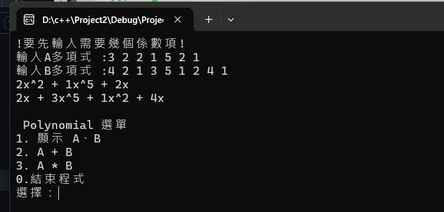
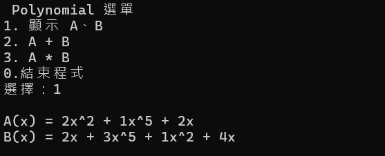
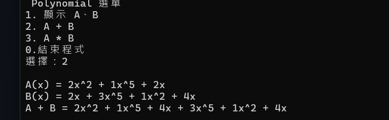
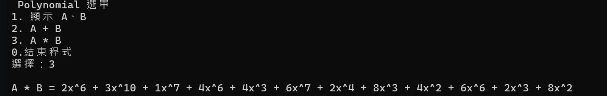
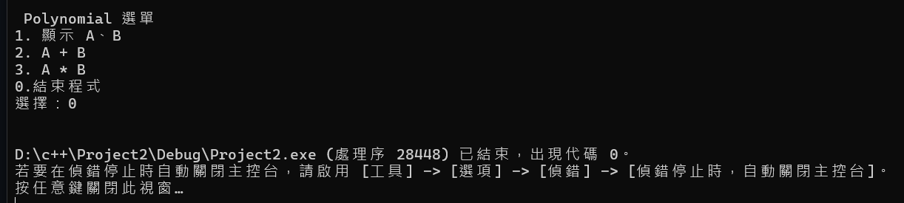

# 41443137
# Homework 2 -多像式加法&乘法運算 
## 1. 解題說明
做指數次方相加與相乘

## 解題想法（How to do?）

程式主要分成以下幾個步驟：

1.建立 Term 類別，儲存多項式每一項的係數與指數。

2.建立 Polynomial 類別，使用動態陣列儲存多項式的各項資料。

3.讓使用者輸入多項式的項數，以及每一項的係數與指數。

4.使用 Add() 函式進行多項式加法，將相同指數的係數相加。

5.使用 Mult() 函式進行多項式乘法，將每一項相乘後，再透過加法合併同類項。

6.使用選單讓使用者選擇顯示多項式、計算加法或計算乘法。
## 2. 實作程式
```cpp
#include <iostream>
#include <cmath>
#include <algorithm>

using namespace std;

class Polynomial;//前置宣告

class Term {
    friend class Polynomial;
private:
    float coef; // 係數
    int exp;    // 指數
};

class Polynomial {
private:
    Term* termArray; //儲存非零項的動態陣列
    int capacity;    //陣列容量
    int terms;       //實際非零項數量
public:
    Polynomial Add(const Polynomial& b);
    Polynomial Mult(const Polynomial& b);
    void Readinput();
    void show();
    void clear() {
        delete[] termArray;
        capacity = 2;
        terms = 0;
        termArray = new Term[capacity];
    }
    Polynomial() :capacity(2), terms(0) {
        termArray = new Term[capacity];
    }
    void newTerm(const float theCoef, const int theExp) {
        if (theCoef == 0)return;
        if (terms == capacity) {
            capacity *= 2;
            Term* temp = new Term[capacity];
            copy(termArray, termArray + terms, temp);
            delete[]termArray;
            termArray = temp;
        }
        termArray[terms].coef = theCoef;
        termArray[terms++].exp = theExp;
    }

};
//數字相加
Polynomial Polynomial::Add(const Polynomial& b) {
    Polynomial c;
    int aPos = 0, bPos = 0;
    while ((aPos < terms) && (bPos < b.terms))
        if (termArray[aPos].exp == b.termArray[bPos].exp) {
            float t = termArray[aPos].coef + b.termArray[bPos].coef;
            if (t) c.newTerm(t, termArray[aPos].exp);
            aPos++; bPos++;
        }
        else if (termArray[aPos].exp < b.termArray[bPos].exp) {
            c.newTerm(b.termArray[bPos].coef, b.termArray[bPos].exp);
            bPos++;
        }
        else {
            c.newTerm(termArray[aPos].coef, termArray[aPos].exp);
            aPos++;
        }
    for (; aPos < terms; aPos++)
        c.newTerm(termArray[aPos].coef, termArray[aPos].exp);
    for (; bPos < b.terms; bPos++)
        c.newTerm(b.termArray[bPos].coef, b.termArray[bPos].exp);
    return c;
}
//數字相乘
Polynomial Polynomial::Mult(const Polynomial& b) {
    Polynomial c;
    for (int i = 0; i < terms; i++) {
        Polynomial temp;
        for (int j = 0; j < b.terms; j++) {
            temp.newTerm(termArray[i].coef * b.termArray[j].coef,
                termArray[i].exp + b.termArray[j].exp);
        }
        c = c.Add(temp);//相同指數進行相加
    }
    return c;
}
//輸入數字
void Polynomial::Readinput() {
    clear();
    int numtemp;
    cin >> numtemp;
    for (int i = 0; i < numtemp; i++) {
        float coef;
        int exp;
        cin >> coef >> exp;
        newTerm(coef, exp);
    }
}
//顯示目前的數值
void Polynomial::show() {
    if (terms == 0) {
        cout << "0\n";
        return;
    }
    for (int i = 0; i < terms; ++i) {
        if (i > 0 && termArray[i].coef > 0) cout << " + ";

        if (termArray[i].exp == 0) {
            cout << termArray[i].coef;
        }
        else if (termArray[i].exp == 1) {
           cout << termArray[i].coef << "x";
        }
        else {
            cout << termArray[i].coef << "x^" << termArray[i].exp;
        }
    }
    cout << "\n";
}
//建立選單
void showMenu() {
    cout << "\n Polynomial 選單 \n";
        cout << "1. 顯示 A、B\n";
        cout << "2. A + B\n"; 
        cout << "3. A * B\n";
        cout << "0.結束程式\n";
        cout << "選擇：";
}


int main() {
    Polynomial A, B;
    cout << "!要先輸入需要幾個係數項!\n";
    cout << "輸入A多項式 :";
    A.Readinput();
    cout << "輸入B多項式 :";
    B.Readinput();
    A.show();
    B.show();

    int choice;
    while (true) {
        showMenu();
        if (!(cin >> choice)) break;

        cout << "\n";
        if (choice == 0) break;

        switch (choice) {
        case 1:
            cout << "A(x) = ";  A.show();
            cout << "B(x) = ";  B.show();
            break;
        case 2: {
            Polynomial C = A.Add(B);
            cout << "A(x) = ";  A.show();
            cout << "B(x) = ";  B.show();
            cout << "A + B = ";  C.show();
            break;
        }
        case 3: {
            Polynomial C = A.Mult(B);
            cout << "A * B = "; C.show();
            break;
          }
        }
    }
    return 0;
```


## 3.時間複雜度與空間複雜度分析

### 1. 時間複雜度（Time Complexity）

假設多項式 A 有 n 個項目，多項式 B 有 m 個項目。

| 操作 | 時間複雜度 | 說明 |
|---|---|---|
| `Readinput()` | O(n) | 逐筆讀取多項式的係數與指數 |
| `show()` | O(n) | 逐一輸出多項式中的所有項目 |
| `Add()` | O(n + m) | 使用雙指標比較兩個多項式的指數，依序合併項目 |
| `Mult()` | O(n × m × (n + m)) | 將兩個多項式的每個項目互相相乘，並透過 `Add()` 合併結果 |

**時間複雜度說明：**

- 多項式加法使用兩個指標依序比較指數，每個項目最多處理一次，因此時間複雜度為 O(n + m)。
- 多項式乘法需要執行 n × m 次項目相乘。
- 目前程式每次相乘後，都會使用 `Add()` 合併結果，因此最壞情況下，每次合併都可能需要線性時間。

### 2. 空間複雜度（Space Complexity）

| 操作 | 空間複雜度 | 說明 |
|---|---|---|
| `Readinput()` | O(n) | 使用動態陣列儲存多項式項目 |
| `show()` | O(1) | 只使用少量額外變數進行輸出 |
| `Add()` | O(n + m) | 建立新的多項式儲存相加結果 |
| `Mult()` | O(n × m) | 最多可能產生 n × m 個相乘項目，需要額外空間儲存結果 |

**空間複雜度說明：**

- `Polynomial` 使用動態陣列 `termArray` 儲存多項式的各個項目。
- 加法結果最多包含 n + m 個項目，因此需要 O(n + m) 的額外空間。
- 乘法最多可能產生 n × m 個項目，因此最壞情況下需要 O(n × m) 的空間。

以上複雜度以多項式項目數量作為分析依據，並假設輸入的多項式指數已經按照由大到小排列。


## 4.程式測試

已以下兩參數作範例

A = 2x^2+1x^5+2x

B = 2x+3x^5+1x^2+4x

| 選單 | 結果 |
|---|---|
|   |輸入測資: 先輸入A的要係數數量，再輸入B的係數數量             |
|   | |
| 1 | 輸入1顯示兩個多項式 |
|    ||
| 2 | 輸入2計算多項式加法 |
|    ||
| 3 | 輸入3計算多項式乘法 |
|    ||
| 0 | 輸入0結束程式 |
|    ||

效能分析主要評估程式執行所需的時間與記憶體空間。


## 程式改善
再輸入數字時,使用者會需要先輸入幾個係數項才能輸入值

## 心得
透過這次多項式加法與乘法的程式作業，我學會了如何用 C++ 的類別、動態陣列與迴圈來解決數學問題。
在實作過程中，我發現多項式不需要用固定大小的陣列，改用動態記憶體配置能讓程式彈性調整空間。加法的部分讓我弄懂怎麼比對指數並合併同類項；乘法則是運用分配律，把複雜運算拆解成簡單步驟來處理。
此外，我也體會到時間與空間複雜度的重要性。雖然程式能算出正確答案，但乘法因為要重複相乘與合併，資料量一大就比較吃效能。
未來如果要做改進，我會想加入自動排序、減少重複項目，並優化記憶體管理。我也會多測試負係數、零係數或常數項等極端情況。這次實作讓我把數學概念順利轉換成演算法，也學到如何透過測試來優化程式

